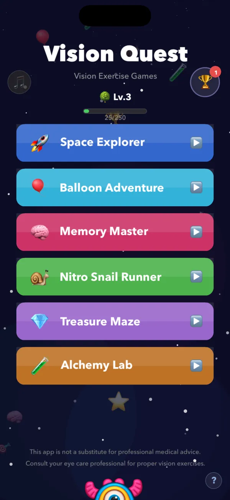
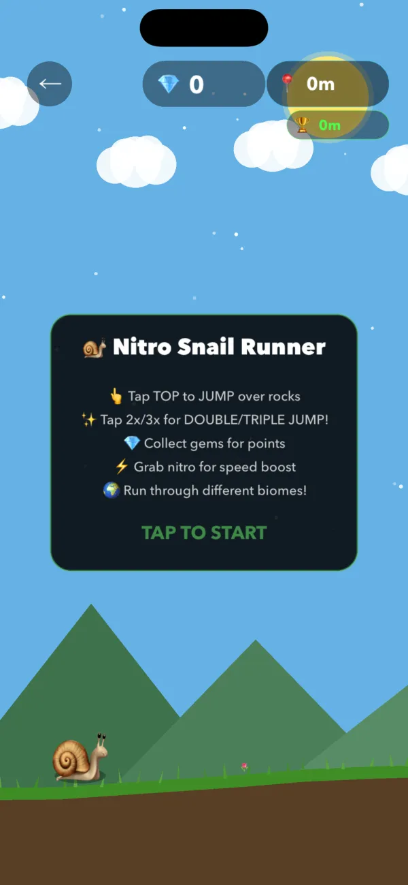

# Vision Quest Games

Six offline arcade and puzzle games for kids on iPhone and iPad.

Vision Quest Games is a collection of six kid-friendly games designed around visual tracking, color matching, and memory. Built for children ages 4 and up and their families, it runs offline on iPhone and iPad with no ads and no in-app purchases. Free. No ads, subscriptions, or in-app purchases.

- Website: https://workmanl.github.io/Vision-Quest-Games/
- App Store: https://apps.apple.com/us/app/vision-quest-games/id6757344701
- Support: https://github.com/workmanl/Vision-Quest-Games/issues
- Email: hello@emrldlabs.com
- Privacy: https://workmanl.github.io/Vision-Quest-Games/privacy.html

## About this repository

The app's source code is not public. This repository is used for support: please open an issue for bug reports and questions.
